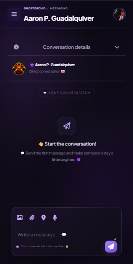

# GhostOrchid Chat App

**A modern web-based chat application by Blackorchid**

GhostOrchid Chat App is a web application built with Laravel, PHP, Vite, and Google Authentication. It combines a modern interface, user authentication, and chat functionality in a responsive design.

## Screenshots

### Login Page

<p align="center">
  
</p>

### Google Sign-In

<p align="center">
  
</p>

### Chat Application

<p align="center">
  
</p>

## Features

- Modern and responsive user interface
- User login and authentication
- Google Authentication integration
- Chat application interface
- Dark-themed design
- Clean and intuitive navigation
- Responsive layouts for desktop and mobile devices

## Tech Stack

| Technology | Purpose |
|---|---|
| **Laravel** | PHP web application framework |
| **PHP** | Backend development and application logic |
| **Vite** | Frontend asset bundling and development server |
| **Google Authentication** | Google sign-in integration |
| **HTML5** | Web page structure |
| **CSS3** | Styling and responsive design |
| **JavaScript** | Frontend interactions |
| **MySQL** | Database, if configured |

## Installation

### Requirements

- PHP version compatible with your Laravel version
- Composer
- Node.js and npm
- Git
- A modern web browser
- MySQL, if required by your configuration

### 1. Clone the Repository

```bash
git clone https://github.com/Blackorchid24/ghostorchidChatApp.git
cd ghostorchidChatApp
```

### 2. Install PHP Dependencies

```bash
composer install
```

### 3. Configure Environment Variables

Copy the example environment file:

```bash
copy .env.example .env
```

Generate the Laravel application key:

```bash
php artisan key:generate
```

Configure your `.env` file with your database settings and Google Authentication credentials.

**Security:** Never commit your `.env` file, Google client secrets, or other private credentials to a public repository.

### 4. Install Frontend Dependencies

```bash
npm install
```

Build the frontend assets:

```bash
npm run build
```

### 5. Configure Google Authentication

Configure your Google OAuth client in the [Google Cloud Console](https://console.cloud.google.com/).

Set the authorized redirect URI to match the callback route configured in your Laravel application. Add the required Google client ID and secret to your environment variables, using the variable names expected by your application.

### 6. Run the Application

Start the Laravel development server:

```bash
php artisan serve
```

Open your browser at:

```text
http://127.0.0.1:8000
```

For frontend development with Vite, open another terminal and run:

```bash
npm run dev
```

## Project Structure

```text
ghostorchidChatApp/
├── app/
├── bootstrap/
├── config/
├── database/
├── public/
├── resources/
│   ├── css/
│   ├── js/
│   └── views/
├── routes/
├── screenshots/
│   ├── google-signin.png
│   ├── login.png
│   └── chat.png
├── storage/
├── tests/
├── .env.example
├── artisan
├── composer.json
├── package.json
├── vite.config.js
└── README.md
```

*Your actual project structure may differ.*

## Development

1. Open the project in Visual Studio Code.
2. Install dependencies using Composer and npm.
3. Configure your environment variables.
4. Run Laravel and Vite during development.
5. Test login, Google Authentication, and chat functionality.
6. Check the layout on desktop and mobile devices.

## Future Improvements

- [ ] Enhance real-time messaging
- [ ] Improve conversation management
- [ ] Add user profile customization
- [ ] Improve mobile responsiveness
- [ ] Add message notifications
- [ ] Strengthen authentication and application security

## Author

**Blackorchid Dev**

GitHub: [@Blackorchid24](https://github.com/Blackorchid24)

## Repository

[GhostOrchid Chat App on GitHub](https://github.com/Blackorchid24/ghostorchidChatApp)

## License

No license has been specified. All rights remain with the copyright holder unless a license is added to the repository.

---

**Developed by Blackorchid**
