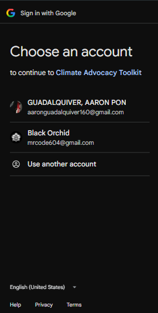
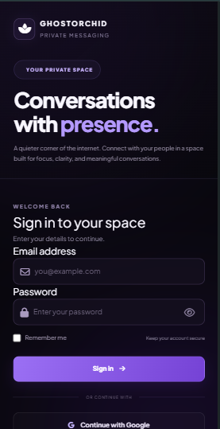

# GhostOrchid Chat App

**A modern web-based chat application by Blackorchid**

GhostOrchid Chat App is a web development project featuring a modern interface, user login, and Google Sign-In. Built with a focus on clean design, usability, and responsive layouts.

## Screenshots

### Google Sign-In

<p align="center">
  
</p>

### Login Page

<p align="center">
  
</p>

## Features

- Modern and responsive user interface
- User login page
- Google Sign-In integration
- Dark-themed design
- Clean and intuitive navigation
- Responsive layouts for desktop and mobile devices

*Features may vary depending on the current implementation.*

## Tech Stack

- HTML5
- CSS3
- JavaScript
- PHP
- MySQL (if configured)
- XAMPP for local development

## Installation

### Requirements

- [XAMPP](https://www.apachefriends.org/)
- Git
- A modern web browser

### 1. Clone the Repository

```bash
git clone https://github.com/Blackorchid24/ghostorchidChatApp.git
```

### 2. Move the Project

Place the project folder inside your XAMPP `htdocs` directory.

Example:

```text
C:\xampp\htdocs\ghostorchid-chat
```

### 3. Start XAMPP

Open the XAMPP Control Panel and start Apache. Start MySQL as well if your application requires a database.

### 4. Configure the Application

Configure your database credentials and authentication settings if required.

For Google Sign-In, configure the appropriate Google OAuth credentials and authorized redirect URI for your local or production environment. Keep private credentials and secrets out of your public repository.

### 5. Run the Application

Open your browser and visit:

```text
http://localhost/ghostorchid-chat/
```

## Project Structure

```text
ghostorchid-chat/
├── screenshots/
│   ├── google-signin.png
│   └── login.png
├── assets/
│   ├── css/
│   ├── js/
│   └── images/
├── README.md
└── ...
```

*Your actual folder structure may differ.*

## Development

1. Open the project in Visual Studio Code.
2. Edit the relevant HTML, CSS, JavaScript, or PHP files.
3. Run the application using XAMPP.
4. Test login and Google Sign-In functionality.
5. Check responsiveness on desktop and mobile devices.

## Future Improvements

- [ ] Improve responsive design
- [ ] Enhance user authentication
- [ ] Improve chat and conversation management
- [ ] Implement real-time messaging, if not yet available
- [ ] Add additional user interface enhancements
- [ ] Improve accessibility and security

## Author

**Blackorchid Dev**

GitHub: [@Blackorchid24](https://github.com/Blackorchid24)

## Repository

[GhostOrchid Chat App](https://github.com/Blackorchid24/ghostorchidChatApp)

## License

No license has been specified. All rights remain with the copyright holder unless a license is added to the repository.

---

**Developed by Blackorchid**
